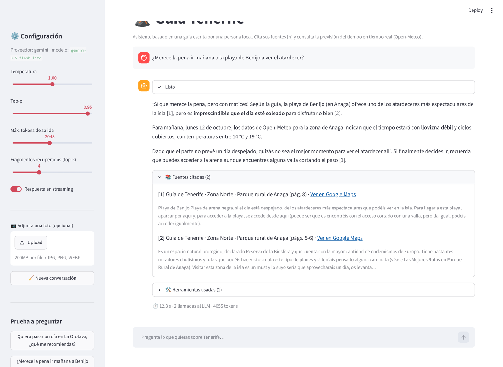

# 🌋 Asistente turístico de Tenerife con LLM

Entrega final de la asignatura **Large Language Models** del *Máster en IA, Cloud Computing y DevOps* (Pontia).

Asistente conversacional que planifica visitas a Tenerife a partir de una guía en PDF escrita por una persona local. Combina:

- **RAG** sobre la guía: chunking estructural, embeddings multilingües, FAISS y búsqueda híbrida con BM25. **Cita cada dato** con el lugar y la página.
- **Diálogo multiturno**: memoria con resumen automático y límite de tokens, y reescritura de preguntas que dependen del contexto ("¿y dónde como por allí?").
- ***Function calling***: `get_weather(fecha, zona)` con la previsión real de Open-Meteo (Pydantic, reintentos, log de intentos) y `buscar_en_guia` para que el modelo haga búsquedas adicionales.
- **Extras (bonus)**: interfaz web en **Streamlit** con **streaming**, varias herramientas coordinadas por el modelo (**agente**), **fotos** como entrada (multimodal) y **observabilidad** con logs JSONL. También incluye Docker y CI.



---

## Requisitos del enunciado → dónde se cumplen

| Requisito | Implementación | Dónde |
|---|---|---|
| LLM comercial vía API, key en variables de entorno | Gemini (o OpenAI) con el SDK oficial de OpenAI; `.env` + `python-dotenv`; key enmascarada en las salidas | `config.py`, `llm.py`, notebook §0 |
| Parámetros del modelo expuestos | `ModelParams` (temperature, top_p, max_tokens, reasoning_effort), configurables por `.env` y desde la app | `config.py`, notebook §0 |
| Chunks + embeddings | Chunking estructural (zona › lugar) comparado con chunking de tamaño fijo; `multilingual-e5-small` | `ingest.py`, `retrieval.py`, notebook §2-4 |
| Vector store | FAISS `IndexFlatIP` (coseno) persistido en disco con manifiesto/caché + BM25 híbrido (RRF) | `retrieval.py`, notebook §3 |
| Respuestas citando la fuente | Fuentes numeradas `[n]` → lugar y página, validación de citas inventadas, enlace a Google Maps en la app | `assistant.py`, notebook §6 |
| Memoria multiturno con control de tokens | *Summary buffer*: resumen de turnos antiguos + últimos turnos literales, contados con `tiktoken`; ventana deslizante de respaldo | `memory.py`, notebook §9 |
| `get_weather` con JSON Schema / Pydantic | `GetWeatherArgs` (fecha + zona enumerada) → JSON Schema simplificado | `tools.py`, notebook §7 |
| Llamada real o simulada + errores | Open-Meteo real (modo `mock` opcional); fechas pasadas o lejanas, argumentos inválidos, timeouts, 5xx | `tools.py`, notebook §7 |
| Registro de intentos en un log | `logs/tool_calls.jsonl`: cada invocación y cada intento HTTP | `tools.py`, notebook §7 y §11 |
| ≥3 invocaciones correctas con manejo de fallos | 3 directas + 15 a través del LLM + 4 errores de validación + caída de red simulada | notebook §6-§8 y §10 |
| Evaluación reproducible, métricas y gráficas | 40 preguntas de recuperación (Hit@k, MRR) + 28 turnos extremo a extremo con 9 comprobaciones (incluido un LLM juez) | `evaluation.py`, `eval/`, notebook §4 y §10 |
| Código PEP 8, docstrings, modular | Paquete `src/tenerife_assistant`, `ruff` (pycodestyle + pydocstyle), 45 tests | `src/`, `tests/`, CI |
| Repositorio, README, requirements, .gitignore | Este repositorio | — |
| Informe final | Diseño, decisiones, resultados, limitaciones y mejoras | [`docs/INFORME.md`](docs/INFORME.md) / PDF |
| **Bonus** | Streamlit, streaming, agente con 2 herramientas, multimodal (fotos), observabilidad, Docker, CI | `app/`, `Dockerfile`, `.github/` |

---

## Estructura del repositorio

```
asistente-turistico-tenerife/
├── src/tenerife_assistant/      # Paquete con toda la lógica
│   ├── config.py                # Configuración y parámetros del modelo (.env)
│   ├── llm.py                   # Cliente LLM: reintentos 429, modelos de reserva, streaming
│   ├── ingest.py                # Lectura del PDF y estrategias de chunking
│   ├── retrieval.py             # Embeddings, FAISS, BM25 y búsqueda híbrida (RRF)
│   ├── memory.py                # Memoria conversacional con presupuesto de tokens
│   ├── tools.py                 # get_weather, buscar_en_guia, registro y validación
│   ├── assistant.py             # Orquestador: RAG + memoria + herramientas + citas
│   └── evaluation.py            # Métricas de recuperación y evaluación extremo a extremo
├── notebooks/
│   └── asistente_tenerife.ipynb # Notebook principal (ejecutado, con todas las salidas)
├── app/streamlit_app.py         # Interfaz web (bonus)
├── data/
│   ├── TENERIFE.pdf             # Guía facilitada por el profesorado
│   └── foto_ejemplo.jpg         # Foto de prueba para la parte multimodal
├── eval/
│   ├── retrieval_questions.json # 40 preguntas + 10 fuera de dominio (recuperación)
│   ├── e2e_cases.json           # 22 casos / 28 turnos (extremo a extremo)
│   └── results/                 # CSV y logs de la última ejecución
├── docs/
│   ├── INFORME.md / INFORME.pdf # Informe final
│   └── img/                     # Diagrama de arquitectura y gráficas
├── tests/                       # Tests con pytest (sin API key ni red al LLM)
├── logs/                        # Logs JSONL de turnos y herramientas (se generan solos)
├── .env.example                 # Plantilla de configuración
├── requirements.txt / requirements-dev.txt / pyproject.toml
├── Dockerfile / .github/workflows/ci.yml
└── README.md
```

---

## Instalación

Requisitos: **Python 3.11 o superior** (probado con 3.12 y 3.13) y conexión a internet. La primera ejecución descarga el modelo de embeddings (~470 MB). La comparativa de modelos de la sección 4 del notebook descarga además otros dos (~1,6 GB).

**Windows (PowerShell)**

```powershell
git clone https://github.com/tmllabres/asistente-turistico-tenerife.git
cd asistente-turistico-tenerife
py -3.12 -m venv .venv
.venv\Scripts\Activate.ps1
pip install -r requirements-dev.txt
```

**Linux / macOS**

```bash
git clone https://github.com/tmllabres/asistente-turistico-tenerife.git
cd asistente-turistico-tenerife
python3 -m venv .venv && source .venv/bin/activate
pip install torch --index-url https://download.pytorch.org/whl/cpu   # solo Linux: evita bajar CUDA (~2 GB)
pip install -r requirements-dev.txt
```

`requirements.txt` instala también el propio paquete en modo editable (`-e .`), así que `import tenerife_assistant` funciona desde cualquier carpeta.

## Configuración

1. Consigue una API key **gratuita** de Gemini en [Google AI Studio](https://aistudio.google.com/apikey) (o usa una de OpenAI).
2. Copia la plantilla y pega la key:

   ```bash
   cp .env.example .env        # en Windows: copy .env.example .env
   ```

   ```ini
   LLM_PROVIDER=gemini
   GEMINI_API_KEY=tu-api-key
   ```

3. Para usar **OpenAI**, basta con `LLM_PROVIDER=openai` y `OPENAI_API_KEY=sk-...` (modelo por defecto `gpt-4.1-mini`).

Todos los parámetros (modelo, temperatura, top-p, tokens, modelo de embeddings, modo del tiempo…) se pueden cambiar en el `.env`; ver los comentarios de [`.env.example`](.env.example).

## Uso

**Notebook principal** (el entregable): `notebooks/asistente_tenerife.ipynb` se entrega **ya ejecutado**, con todas las salidas. Para reproducirlo, ábrelo en Jupyter o VS Code y ejecuta todas las celdas (*Run All*). Tarda unos 5-10 minutos, sobre todo por la evaluación extremo a extremo.

**App web (bonus):**

```bash
streamlit run app/streamlit_app.py
```

Se abre en `http://localhost:8501`. Tiene preguntas de ejemplo, respuestas en streaming, estado de las herramientas, fuentes citadas con enlace a Google Maps, subida de fotos y controles de temperatura, top-p, tokens y top-k.

**Como librería:**

```python
from tenerife_assistant.assistant import create_assistant

bot = create_assistant()
r = bot.chat("¿Merece la pena ir mañana a Benijo a ver el atardecer?")
print(r.text)
print(r.format_sources())
```

**Docker:**

```bash
docker build -t asistente-tenerife .
docker run -p 8501:8501 --env-file .env asistente-tenerife
```

## Calidad: tests, lint y CI

```bash
pytest            # 45 tests: ingesta, recuperación, herramientas, memoria, LLM y orquestador
ruff check src tests app && ruff format --check src tests app
```

Los tests usan un **LLM falso guionizado** y un **embedder falso**, así que no necesitan API key ni descargar modelos. GitHub Actions los ejecuta en cada *push* (`.github/workflows/ci.yml`).

## Resultados principales

Última ejecución completa del notebook (Gemini 3.5 Flash-Lite, 11/10/2026):

| Evaluación | Resultado |
|---|---|
| Recuperación (40 preguntas, 31 parafraseadas) | Hit@1 **0,80** · Hit@4 **0,95** · MRR **0,86** |
| Chunking estructural frente a fijo (MRR) | 0,83-0,90 frente a 0,71-0,82 |
| Extremo a extremo (22 casos, 28 turnos) | 100 % en datos clave, citas, herramienta correcta, rechazo fuera de dominio, errores controlados y *prompt injection* |
| LLM juez (Gemma 4 26B, validado con una alucinación inyectada) | fidelidad **5,0/5** · precisión de citas **4,9/5** |
| Latencia por turno | mediana 1,5 s · p95 9,6 s (incluye esperas por el límite de 15 peticiones por minuto) |
| Herramientas | 16 invocaciones; 3 de 20 intentos HTTP fallidos, todos recuperados con reintentos |


El análisis completo está en el [informe](docs/INFORME.md) y en el notebook (§4, §10 y §12).

## Solución de problemas

| Síntoma | Causa y solución |
|---|---|
| `Falta la variable GEMINI_API_KEY` | No existe el `.env` o está vacío. Copia `.env.example` a `.env` y pega la key. |
| `Se ha agotado la cuota diaria gratuita del modelo…` | El plan gratuito de Gemini limita las peticiones por día y modelo. El cliente cambia solo a los modelos de `LLM_FALLBACK_MODELS`; si se agotan todos, espera al día siguiente o usa otro `LLM_MODEL`. |
| Mensajes `Límite de peticiones por minuto (429). Reintento en N s` | Normal en el plan gratuito: el cliente espera lo que indica la API y reintenta. |
| La primera ejecución tarda | Se descarga el modelo de embeddings y se construye el índice. Después se carga de `index/` en segundos. |
| `get_weather intento 1/3 fallido` | Open-Meteo tardó en responder; se reintenta automáticamente. Sin conexión, usa `WEATHER_MODE=mock`. |

## Créditos

- Guía turística de Tenerife facilitada por el profesorado de la asignatura.
- Datos meteorológicos de [Open-Meteo](https://open-meteo.com) (CC BY 4.0).
- Embeddings: [`intfloat/multilingual-e5-small`](https://huggingface.co/intfloat/multilingual-e5-small).
