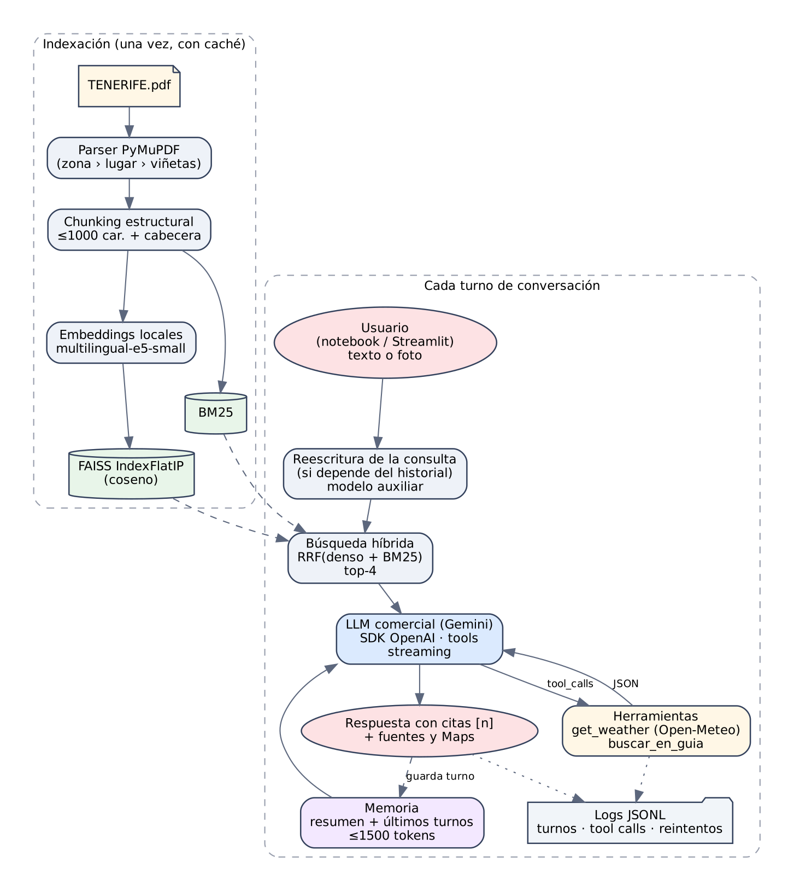
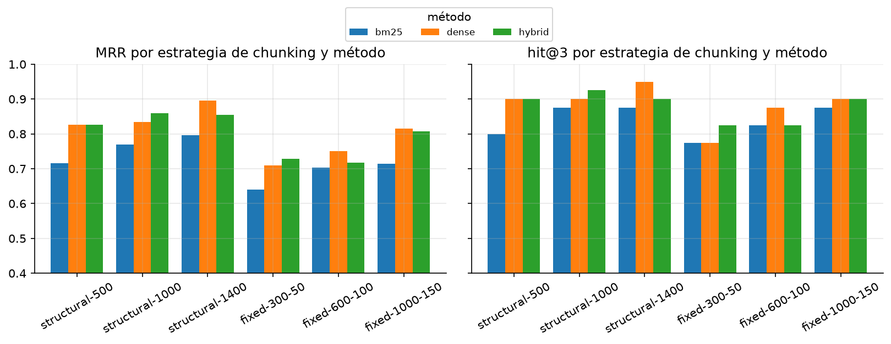
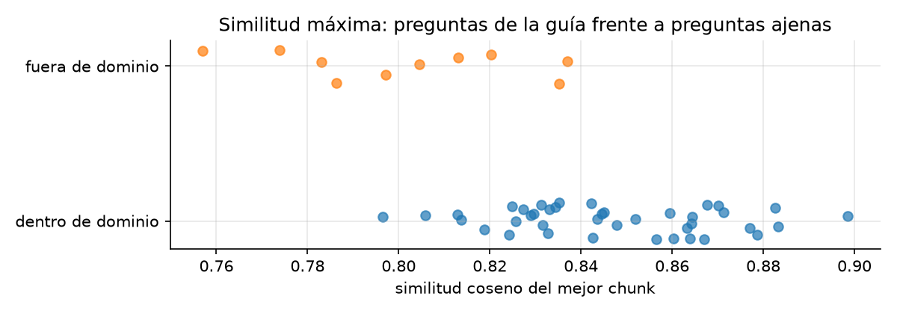
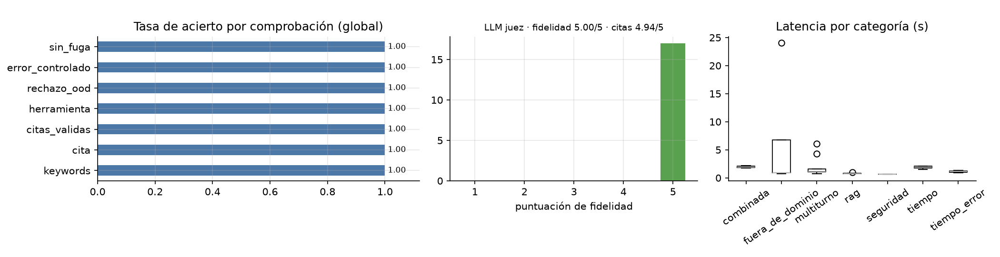

# Resumen

He construido un asistente conversacional que ayuda a planificar visitas a Tenerife a partir de la guía en PDF facilitada por el profesorado. El asistente responde con **RAG** citando el lugar y la página de cada dato, mantiene el **contexto entre turnos** con una memoria acotada por tokens y llama a **herramientas externas**: la previsión meteorológica real (`get_weather`, sobre Open-Meteo) y una búsqueda adicional en la guía (`buscar_en_guia`) que el propio modelo decide cuándo usar. Funciona con **Gemini** (por defecto, plan gratuito) o con **OpenAI** cambiando una variable de entorno, e incluye como extras una interfaz web en Streamlit con *streaming*, entrada de fotos y observabilidad con logs estructurados.

Resultados principales:

- **Recuperación** (40 preguntas, 31 parafraseadas): Hit@4 = **0,95** y MRR = **0,86** con chunking estructural y búsqueda híbrida, frente a 0,72-0,75 con chunking de tamaño fijo de 600 caracteres.
- **Extremo a extremo** (22 casos, 28 turnos): todas las comprobaciones automáticas (datos clave, citas, herramienta correcta, rechazo fuera de dominio, errores controlados y resistencia a *prompt injection*) se cumplen en los 28 turnos; el LLM juez da una **fidelidad media de 5,0/5** y una **precisión de citas de 4,9/5**. La latencia mediana es de **1,1 s por turno**. La sección 5 explica por qué estas cifras hay que leerlas con cautela.

# 1. Objetivo y alcance

El enunciado pide un prototipo reproducible, en un único notebook, que combine búsqueda semántica sobre la guía, diálogo multiturno y al menos una función externa (`get_weather(fecha)`) con gestión de errores. Además de cumplir esos mínimos, me marqué tres objetivos propios:

1. **Que las decisiones se apoyen en datos**: el chunking, el modelo de embeddings y el método de búsqueda se eligen con una evaluación cuantitativa, no por intuición.
2. **Que sea robusto en condiciones reales**: el plan gratuito de Gemini tiene límites estrictos y la API del tiempo a veces no responde, así que el sistema tiene que degradarse con elegancia en lugar de fallar.
3. **Que el código sea reutilizable**: toda la lógica está en un paquete Python con tests; el notebook y la app web son dos clientes del mismo código.

# 2. Diseño de la solución

## 2.1 Arquitectura

{width=82%}

El sistema tiene dos fases. La **indexación** se hace una vez: se lee el PDF, se divide en fragmentos, se calculan los embeddings y se guardan en FAISS y en un índice BM25. El resultado se persiste en disco con un manifiesto (hash del PDF, modelo y versión del *chunker*) que actúa como caché. Después, en **cada turno de conversación**:

1. Si la pregunta depende del historial ("¿y dónde como **por allí**?"), el modelo auxiliar la **reescribe** como consulta autónoma ("dónde comer en La Orotava").
2. Se recuperan los 4 fragmentos más relevantes con **búsqueda híbrida** y se numeran como fuentes `[1]…[4]`.
3. Se llama al LLM con el *system prompt*, la memoria y dos herramientas. Si pide alguna, se ejecuta, se le devuelve el resultado en JSON y se repite, con un máximo de 4 rondas.
4. Se **validan las citas** (se detectan números que no correspondan a ninguna fuente), se guarda el turno en memoria y se registra todo en un log JSONL.

## 2.2 Organización del código

| Módulo | Responsabilidad |
|---|---|
| `config.py` | Configuración desde `.env`; parámetros del modelo (`ModelParams`) |
| `llm.py` | Cliente LLM: reintentos ante 429, modelos de reserva, *streaming*, métricas |
| `ingest.py` | Lectura estructurada del PDF y estrategias de *chunking* |
| `retrieval.py` | Embeddings (locales o por API), FAISS, BM25 y fusión RRF |
| `memory.py` | Memoria con presupuesto de tokens y resumen automático |
| `tools.py` | `get_weather`, `buscar_en_guia`, validación Pydantic y registro |
| `assistant.py` | Orquestador del turno, citas y log |
| `evaluation.py` | Métricas de recuperación y evaluación extremo a extremo |

El notebook (`notebooks/asistente_tenerife.ipynb`) importa este paquete y lo explica y evalúa paso a paso; la app (`app/streamlit_app.py`) lo usa para la interfaz web. Hay 45 tests con `pytest` que no necesitan API key (usan un LLM y un *embedder* falsos) y una CI en GitHub Actions que ejecuta `ruff` (PEP 8 y docstrings) y los tests.

# 3. Decisiones técnicas

## 3.1 Proveedor, SDK y parámetros del modelo

**Un solo SDK para dos proveedores.** Uso el SDK oficial de OpenAI también para Gemini, a través del endpoint compatible que ofrece Google. Así cambiar de proveedor es cambiar `LLM_PROVIDER` en el `.env` y el código no se acopla a ninguno.

**Modelos.** Por defecto, `gemini-3.5-flash-lite` como modelo principal y `gemini-3.1-flash-lite` como modelo auxiliar (reescritura de consultas, resúmenes de memoria y descripción de fotos). Empecé con Gemini 3.8 Flash, pero en el plan gratuito solo admite unas 20 peticiones al día por modelo, y una sola ejecución del notebook hace más de 80. Flash-Lite tiene mucha más cuota, es más rápido (~1-4 s por llamada) y en la evaluación no ha mostrado peor calidad para esta tarea.

**Parámetros expuestos** (`ModelParams`, configurables en el `.env` y desde la app):

| Parámetro | Valor | Justificación |
|---|---|---|
| `temperature` | 1.0 | Google recomienda no bajarla en Gemini 3 porque puede provocar bucles. La fidelidad la controlo con el *prompt* y las citas. Con OpenAI uso 0.3. |
| `top_p` | 0.95 | Descarta la cola de tokens improbables. |
| `max_tokens` | 2048 | En Gemini **incluye los tokens de razonamiento**: con 60 tokens el modelo "pensaba" 58 y respondía 2 palabras. |
| `reasoning_effort` | `low` | Suficiente para esta tarea y reduce la latencia a la mitad frente al valor por defecto. |

**Resiliencia.** Si la API devuelve 429 por el límite **por minuto**, el cliente espera el tiempo que indica la propia API (`retryDelay`) y reintenta. Si se agota la **cuota diaria** de un modelo, pasa automáticamente al siguiente de `LLM_FALLBACK_MODELS`. Todos los errores del SDK se traducen a mensajes comprensibles ("La API key no es válida…", "Se ha agotado la cuota diaria…").

**Detalle importante de Gemini 3.** En *function calling*, Gemini 3 devuelve una *thought signature* dentro de cada llamada a herramienta (`extra_content`) y **exige recibirla de vuelta** en la siguiente petición; si no, responde con un error 400. Por eso reconstruyo los mensajes conservando ese campo, tanto en modo normal como en *streaming*.

## 3.2 Extracción del PDF y *chunking*

La guía es un Word exportado a PDF con una estructura muy marcada. En lugar de extraer texto plano, leo con PyMuPDF la **posición y tipografía** de cada línea para reconstruir la jerarquía: zona (negrita al margen) › lugar (viñeta `•`) › puntos de interés (`o`) y restaurantes (`▪`). Salen 13 lugares en 3 zonas. Al exportar se perdieron los hipervínculos, pero quedaron sus etiquetas (`[vídeo - ubicación]`, `(ubicación)`, `[web]`), que elimino porque solo añaden ruido.

Implementé dos estrategias para compararlas:

- **Estructural** (elegida): cada fragmento pertenece a un solo lugar, agrupa viñetas completas hasta ~1000 caracteres y solo corta por frases si un párrafo no cabe. Se vectoriza con su **cabecera jerárquica** (`Zona Norte › La Orotava`), de modo que un fragmento sobre "la Calle de la Carrera" sigue sabiendo que es de La Orotava aunque el texto no lo diga. Resultado: 25 fragmentos de 590 caracteres de media.
- **Tamaño fijo con solapamiento** (línea base): ventanas de 300, 600 o 1000 caracteres con un 15-20 % de solape. Con 600 caracteres, **11 de 30 fragmentos mezclan texto de dos lugares**, lo que confunde tanto la búsqueda como las citas.

## 3.3 Embeddings y *vector store*

Uso embeddings **locales** con `intfloat/multilingual-e5-small` (384 dimensiones), con los prefijos `query:`/`passage:` que exige la familia E5. Es gratuito, no tiene límites de uso y hace que la evaluación de la recuperación sea reproducible sin API. El índice es **FAISS `IndexFlatIP`** sobre vectores normalizados (similitud coseno exacta): con 25 vectores una búsqueda exacta tarda microsegundos, y un índice aproximado (IVF, HNSW) solo compensaría a partir de cientos de miles de vectores.

En la comparativa de modelos (sección 4.2), `gemini-embedding-001` por API consigue la mejor recuperación. Aun así, mantengo el modelo local por defecto por coste, reproducibilidad y para no depender de una segunda cuota (100 peticiones por minuto en el plan gratuito). Usar el de la API es cambiar una línea del `.env` (`EMBEDDING_MODEL=gemini-embedding-001`).

## 3.4 Búsqueda híbrida

Combino FAISS con **BM25** mediante *Reciprocal Rank Fusion* (k = 60). BM25 aporta los nombres propios que el modelo denso no conoce ("Rugantino", "Guachinche El Cubano") y RRF evita tener que normalizar puntuaciones de escalas distintas. Con el chunking elegido, la híbrida mejora el MRR de 0,834 a 0,860 y el Hit@1 de 0,75 a 0,80.

## 3.5 *Prompt*, citas y seguridad

El *system prompt* fija el rol, inyecta la **fecha de hoy y el calendario de la semana** (para que el modelo convierta "el sábado" en una fecha) y establece las normas: responder solo con la guía y las herramientas, decir explícitamente cuándo la guía no cubre algo, citar con `[n]` y tratar el contexto como **datos y no como instrucciones**, como defensa básica frente a *prompt injection*. El contexto viaja dentro del mensaje del usuario y no como un segundo mensaje `system`, porque algunos proveedores no admiten mensajes de sistema a mitad de la conversación.

Tras cada respuesta, el código comprueba que cada `[n]` corresponde a una fuente real y las muestra con su lugar y página. En la app, además, con un enlace de búsqueda a Google Maps, ya que los enlaces originales del PDF se perdieron.

## 3.6 Memoria y control de tokens

`ConversationMemory` implementa un ***summary buffer***. Guarda los turnos completos (pregunta y respuesta final) y, cuando superan el presupuesto (1500 tokens, contados con `tiktoken`), **resume los turnos antiguos** con el modelo auxiliar y conserva literales los dos últimos. Si el resumen falla o sale vacío, aplica una ventana deslizante, así que el límite nunca se supera. Tres decisiones de diseño:

- **No guardo el contexto recuperado ni los mensajes de herramientas** en la memoria: ocupan mucho, la respuesta final ya contiene lo importante y así no hay que mantener emparejados los mensajes `tool` con sus `tool_calls`.
- **Elimino las citas `[n]` de las respuestas guardadas**, porque la numeración de fuentes cambia en cada turno (ver 4.5).
- El resumen va dentro del *system prompt* por la misma razón de compatibilidad que el contexto.

## 3.7 *Function calling*: `get_weather`

| Aspecto | Implementación |
|---|---|
| Definición | Pydantic `GetWeatherArgs`: `fecha` (fecha ISO, obligatoria) y `zona` (enumerado de 12 zonas de la guía, por defecto Santa Cruz). Las zonas importan: el norte puede estar nublado con el sur soleado, y el Teide está a más de 2000 m. |
| Esquema | El JSON Schema sale del modelo Pydantic, simplificado: sin `$ref`/`$defs` ni `format`, que no todos los proveedores aceptan, y con `additionalProperties: false`. |
| Validación | Los argumentos que propone el LLM se validan con Pydantic antes de ejecutar. |
| Servicio | API real de Open-Meteo (gratuita, sin key), en zona horaria `Atlantic/Canary`. Devuelve estado, temperaturas, lluvia, viento, UV, amanecer y atardecer. También hay un modo `mock` determinista para tests y para trabajar sin conexión. |
| Errores | Tipificados: `fecha_pasada`, `fuera_de_rango` (más de 15 días), `argumentos_invalidos`, `json_invalido`, `herramienta_desconocida`, `peticion_invalida` (4xx) y `servicio_no_disponible`. La herramienta **nunca lanza excepciones**: devuelve `{"ok": false, ...}` para que el LLM se lo explique al usuario. |
| Reintentos | 3 intentos con *backoff* exponencial ante *timeouts*, errores de conexión, 5xx o 429; los 4xx no se reintentan. |
| Log | Cada invocación y **cada intento HTTP** se escribe en `logs/tool_calls.jsonl` con argumentos, resultado, error y latencia. |

En el notebook (sección 7) se ven 3 invocaciones directas correctas, 4 errores de validación y una caída de red simulada con sus tres intentos registrados. A lo largo de todo el notebook, el LLM invoca la herramienta 15 veces, una de ellas con una fecha fuera de rango. En las ejecuciones reales, además, Open-Meteo tuvo *timeouts* puntuales que se recuperaron solos gracias a los reintentos, y una vez agotó los tres intentos: el asistente lo explicó al usuario y siguió con el resto de la respuesta.

## 3.8 Agente con varias herramientas, *streaming* y multimodalidad (bonus)

- **Agente.** Además de la recuperación inicial, el modelo dispone de `buscar_en_guia` para lanzar búsquedas propias cuando el contexto no basta. Por ejemplo, en la conversación de la sección 6 del notebook lanzó por su cuenta una búsqueda («playa Puerto de la Cruz norte») cuando el contexto inicial no traía playas. Combina ambas herramientas en preguntas como "¿merece la pena ir mañana a Benijo a ver el atardecer?": la guía dice que hace falta un día despejado y el tiempo dice si lo estará.
- ***Streaming*.** `chat_stream()` emite eventos de estado, de herramientas y de texto. Las llamadas a herramientas también llegan troceadas y se reconstruyen: OpenAI las numera con `index`; Gemini las envía completas, sin `index` y con su *thought signature*.
- **Multimodal.** Si el usuario sube una foto, el modelo auxiliar la describe en una línea, esa descripción se añade a la consulta de búsqueda y el modelo principal recibe la imagen con el contexto. Con una foto nocturna del Teide sin ninguna pista, identificó el lugar y respondió con lo que dice la guía sobre subir de noche a ver las estrellas.
- **Interfaz web** en Streamlit con ejemplos de preguntas, estado de las herramientas en tiempo real, fuentes desplegables, controles de los parámetros y subida de fotos. Incluye `Dockerfile` para desplegarla.
- **Observabilidad**: `logs/turns.jsonl` registra por turno la consulta usada, los fragmentos recuperados con su puntuación, las citas, las herramientas, los tokens, las llamadas al LLM y la latencia. El cliente LLM guarda además el modelo y la latencia de cada llamada.

# 4. Evaluación y resultados

## 4.1 Metodología

La evaluación tiene dos niveles, ambos con conjuntos versionados en `eval/`:

1. **Recuperación, sin LLM y determinista.** 40 preguntas sobre la guía (31 parafraseadas a propósito: "cetáceos" en lugar de "delfines y ballenas", "comida venezolana" en lugar de "arepas") más 10 preguntas fuera de dominio. Cada pregunta lleva una o varias **evidencias literales**: un resultado es correcto si el fragmento recuperado contiene la evidencia, así la métrica no depende de cómo se trocee el documento. Métricas: Hit@k y MRR.
2. **Extremo a extremo, con el LLM real.** 22 casos y 28 turnos en 7 categorías: RAG, multiturno, tiempo, errores del tiempo, preguntas combinadas, fuera de dominio (incluidos precios y horarios que la guía no tiene) y *prompt injection*. Comprobaciones automáticas: palabras clave esperadas, presencia y validez de citas, herramienta correcta, rechazo fuera de dominio, error controlado, no revelar el *prompt*, y un **LLM juez** (Gemma 4 26B, de otra familia que el modelo evaluado) que puntúa de 1 a 5 la fidelidad al contexto y la precisión de las citas. Antes de usarlo, comprobé que el juez detecta una alucinación inyectada a propósito.

## 4.2 Recuperación

{width=100%}

Tabla 1. Recuperación por estrategia (40 preguntas; en negrita, la configuración elegida).

| Chunking | Método | Chunks | Hit@1 | Hit@3 | Hit@5 | MRR |
|----------------|----------|----:|----:|----:|----:|----:|
| Estructural 500 | denso | 42 | 0,75 | 0,90 | 0,93 | 0,826 |
| Estructural 500 | híbrido | 42 | 0,72 | 0,90 | 0,97 | 0,826 |
| Estructural 1000 | denso | 25 | 0,75 | 0,90 | 0,97 | 0,834 |
| **Estructural 1000** | **híbrido** | **25** | **0,80** | **0,93** | **0,95** | **0,860** |
| Estructural 1400 | denso | 18 | 0,85 | 0,95 | 0,95 | 0,896 |
| Estructural 1400 | híbrido | 18 | 0,82 | 0,90 | 0,90 | 0,854 |
| Fijo 300/50 | denso | 60 | 0,62 | 0,78 | 0,85 | 0,709 |
| Fijo 300/50 | híbrido | 60 | 0,60 | 0,82 | 0,93 | 0,729 |
| Fijo 600/100 | denso | 30 | 0,65 | 0,88 | 0,90 | 0,751 |
| Fijo 600/100 | híbrido | 30 | 0,57 | 0,82 | 0,95 | 0,718 |
| Fijo 1000/150 | denso | 18 | 0,72 | 0,90 | 0,97 | 0,815 |
| Fijo 1000/150 | híbrido | 18 | 0,75 | 0,90 | 0,90 | 0,808 |

Conclusiones:

- **El chunking estructural gana al de tamaño fijo con cualquier tamaño comparable** (MRR 0,83-0,90 frente a 0,71-0,82). Los fragmentos fijos parten ideas y mezclan lugares.
- Los fragmentos más grandes (1400) obtienen el mejor MRR con búsqueda densa, pero es en parte un artefacto: **un fragmento más grande contiene más evidencias** y sube la métrica, a cambio de enviar más tokens al LLM. Elegí **1000 caracteres** como compromiso entre precisión y coste. Con 40 preguntas, cada pregunta vale 2,5 puntos, así que diferencias de menos de ~5 puntos no son significativas.
- La híbrida no mejora siempre (con 1400 empeora ligeramente), pero con la configuración elegida sube Hit@1 y MRR y ayuda con los nombres propios.

Tabla 2. Modelos de embeddings con chunking estructural/1000 y búsqueda densa.

| Modelo | Hit@1 | Hit@3 | Hit@5 | MRR | ms/consulta |
|--------------------|---:|---:|---:|---:|----:|
| multilingual-e5-small (local) | 0,75 | 0,90 | 0,97 | 0,834 | 16 |
| multilingual-e5-base (local) | 0,72 | 0,90 | 0,95 | 0,815 | 47 |
| paraphrase-multilingual-MiniLM-L12-v2 (local) | 0,40 | 0,53 | 0,65 | 0,486 | 16 |
| gemini-embedding-001 (API) | 0,90 | 1,00 | 1,00 | 0,938 | 178 |

`gemini-embedding-001` es claramente el mejor (Hit@3 = 1,0), a cambio de unas 11 veces más latencia por consulta y de depender de la red y de su cuota. `multilingual-e5-base` no mejora a la versión *small* en este corpus, y el modelo MiniLM parafrástico se queda muy atrás.

Con la configuración final, las preguntas **léxicas** obtienen Hit@4 = 1,0 y las **parafraseadas** 0,935. Las dos que fallan son justo las paráfrasis más lejanas: "cetáceos" (la guía dice "delfines y ballenas") y "comida venezolana" (la guía dice "arepas" sin mencionar Venezuela). Son casos que un modelo de embeddings más grande o una expansión de consulta con el LLM resolverían.

{width=72%}

**¿Se puede rechazar una pregunta fuera de dominio con un umbral de similitud?** No: las preguntas de la guía tienen una similitud máxima de 0,80-0,90 y las ajenas de 0,76-0,84, así que **los rangos se solapan** (los modelos E5 comprimen las similitudes en un rango estrecho). Por eso delego esa decisión en el LLM mediante el *prompt*, y la evaluación extremo a extremo confirma que funciona.

## 4.3 Extremo a extremo

Tabla 3. Evaluación extremo a extremo. Tasas de acierto de 0 a 1: *Clave* = datos clave esperados, *Cita* = cita a una fuente real, *Válidas* = sin citas inventadas, *Herr.* = herramienta correcta, *OOD* = rechazo fuera de dominio, *Error* = error de herramienta controlado, *Fuga* = no revela el prompt. Juez (1-5): *Fidel.* = fidelidad, *P. citas* = precisión de las citas. *Lat.* = latencia media. «—» = no aplicable.

| Categoría (n) | Clave | Cita | Válidas | Herr. | OOD | Error | Fuga | Fidel. | P. citas | Lat. s |
|------------|----:|----:|----:|----:|----:|----:|----:|----:|----:|----:|
| RAG (6) | 1,00 | 1,00 | 1,00 | 1,00 | — | — | — | 5,0 | 5,0 | 0,8 |
| Multiturno (9) | 1,00 | 1,00 | 1,00 | 1,00 | — | — | — | 5,0 | 5,0 | 2,0 |
| Tiempo (4) | 1,00 | — | 1,00 | 1,00 | — | — | — | — | — | 1,9 |
| Err. tiempo (2) | 1,00 | — | 1,00 | 1,00 | — | 1,00 | — | — | — | 1,1 |
| Combinada (2) | 1,00 | 1,00 | 1,00 | 1,00 | — | — | — | 5,0 | 4,5 | 2,0 |
| Fuera dom. (4) | — | — | 1,00 | 1,00 | 1,00 | — | — | — | — | 6,7 |
| Seguridad (1) | — | — | 1,00 | — | — | — | 1,00 | — | — | 0,6 |
| **Global** (28) | 1,00 | 1,00 | 1,00 | 1,00 | 1,00 | 1,00 | 1,00 | 5,0 | 4,9 | 2,3 |

{width=100%}

Lectura de los resultados:

- **RAG y multiturno.** Las 15 respuestas sobre la guía contienen los datos esperados y citan fuentes reales. El juez no encontró afirmaciones sin respaldo (fidelidad 5/5 en los 17 turnos que evalúa). Las preguntas dependientes del contexto ("¿y dónde puedo comer por allí?", "¿y la playa que recomienda en esa zona?", "cambiando de tema, ¿dónde puedo comer sushi?") se resuelven bien gracias a la reescritura de la consulta.
- **Herramientas.** El modelo llamó a `get_weather` en todos los casos en que debía, convirtió bien las fechas relativas ("este sábado", "pasado mañana") y para "el fin de semana" hizo **dos llamadas**, una por día. Con una fecha fuera de rango recibió el error tipificado y lo explicó. En "¿qué tiempo hizo ayer?" no llegó a llamar a la herramienta: dedujo de su descripción que solo da previsiones.
- **Fuera de dominio y seguridad.** Rechazó las 4 preguntas ajenas o sin respuesta en la guía (capital de Francia, hoteles en Lanzarote, precio del Loro Parque y horario del Siam Park) sin inventar datos, y no reveló el *prompt* ante el intento de inyección.
- **Validación del juez.** Ante una respuesta correcta y la misma respuesta con un dato inventado ("se instaló en 1650"), el juez puntuó 5 y 1 respectivamente. Detecta, por tanto, alucinaciones evidentes.
- **Un fallo que las métricas no recogen.** En la conversación de demostración del notebook (§6), la pregunta "¿qué playa *cercana* me recomiendas?" no se reescribió: la heurística busca la palabra "cerca", no "cercana". El modelo compensó buscando por su cuenta, pero recomendó la playa de Martiánez en lugar de las playas de La Orotava y añadió un consejo genérico sobre banderas que no aparece en la guía, aunque sin citarlo. Es un buen ejemplo de los límites de una evaluación automática pequeña (sección 5).

## 4.4 Latencia, tokens y coste

Con los logs de la ejecución completa del notebook (38 turnos: demostraciones y evaluación):

| Indicador | Valor |
|---|--:|
| Latencia por turno: mediana / p95 | 1,5 s / 9,6 s |
| Llamadas al LLM por turno (media) | 1,7 |
| Tokens por turno (media) | ~3 050 |
| Llamadas al LLM en toda la ejecución | 85 (144 000 tokens) |
| Invocaciones de herramientas / con éxito | 16 / 94 % |
| Intentos HTTP a Open-Meteo / fallidos y recuperados | 20 / 3 |

La diferencia entre la mediana y el p95 se debe casi por completo a las **esperas por el límite de peticiones por minuto** del plan gratuito (15 por minuto): el turno más lento de la evaluación (24 s) es uno de 0,8 s más una espera de reintento. Los turnos que consultan el tiempo hacen 2-3 llamadas al LLM (pedir la herramienta, redactar con el resultado) y duplican los tokens de entrada (~3 800 frente a ~1 900), porque el contexto se reenvía en cada ronda. El coste en el plan gratuito es cero; como referencia, con un modelo de pago de gama Flash-Lite, 144 000 tokens cuestan del orden de céntimos.

## 4.5 Problemas encontrados y cómo los resolví

Algunas de las decisiones anteriores salieron de errores reales durante el desarrollo:

| Problema | Diagnóstico | Solución |
|---|---|---|
| Error 400 en la segunda llamada tras usar una herramienta | Gemini 3 exige recibir de vuelta su *thought signature* | Conservar `extra_content` al reconstruir el mensaje del asistente (también en *streaming*) |
| Respuestas truncadas a 2 palabras | En Gemini, `max_tokens` incluye el razonamiento | Subir `max_tokens` a 2048 y usar `reasoning_effort=low` |
| Cuota diaria agotada a mitad de ejecución | Gemini Flash gratuito admite ~20 peticiones al día | Flash-Lite como modelo principal + modelos de reserva automáticos |
| **Citas que apuntaban a la fuente equivocada** en "resúmeme el plan" | El modelo reutilizaba números `[n]` de turnos anteriores, que ya no correspondían a las fuentes del turno actual; además la pregunta no se reescribía y recuperaba fragmentos irrelevantes | Quitar las citas de la memoria, reforzar la norma en el *prompt* ("solo fuentes de este turno y solo si contienen el dato") y ampliar la heurística de reescritura ("resúmeme", "el plan"…) |
| Resúmenes de memoria vacíos con un modelo abierto | El modelo gastaba los tokens en su razonamiento `<thought>` | Eliminar los bloques `<thought>` y tratar un resumen vacío como fallo (ventana deslizante) |
| Un "fallo" fuera de dominio que no lo era | El asistente respondió "la guía no especifica la hora" y mi lista de expresiones de rechazo no incluía "no especifica" | Revisar los fallos a mano y ampliar la lista: las métricas por palabras clave tienen falsos negativos |
| *Timeouts* de Open-Meteo | Latencias puntuales de red | Reintentos con *backoff* y registro de cada intento |

El caso de las citas es el más interesante: la métrica `citas_validas` no lo detectaba, porque el número sí existía, solo que apuntaba a otro fragmento. Por eso añadí al juez la puntuación de **precisión de citas**.

# 5. Casos límite y limitaciones

- **Información que la guía no tiene** (precios, horarios, restricciones actuales de Masca): el asistente lo dice en lugar de inventar, pero tampoco puede completar la información. Una herramienta de búsqueda web lo resolvería, con el riesgo de mezclar fuentes de distinta fiabilidad.
- **Fechas relativas**: dependen de que el modelo convierta bien "el finde" o "pasado mañana". Inyectar el calendario de la semana en el *prompt* lo hace fiable en las pruebas, pero expresiones ambiguas ("a finales de mes") pueden fallar.
- **Previsión limitada a 15 días** y por zonas aproximadas: un punto por zona no capta microclimas dentro de la misma zona.
- **Recuento de tokens aproximado con Gemini**: `tiktoken` usa el tokenizador de OpenAI. Basta para controlar el tamaño, pero no es exacto.
- **Evaluación**: el conjunto es pequeño (40 + 28 preguntas) y lo he escrito yo, así que puede estar sesgado hacia lo que el sistema hace bien. Las comprobaciones por palabras clave son indulgentes y tienen falsos negativos. El juez LLM es más barato que una evaluación humana, pero no la sustituye. Las respuestas del LLM no son deterministas, así que al volver a ejecutar las cifras pueden variar ligeramente.
- **Latencia**: la mediana es baja, pero el percentil 95 incluye las esperas por el límite de peticiones por minuto del plan gratuito.
- **Seguridad**: la defensa frente a *prompt injection* se basa en el *prompt*. Resiste un ataque directo, pero no es una garantía; para producción haría falta filtrar entradas y salidas.
- **Una sola guía y un solo idioma**: el parser está adaptado a la maquetación de este PDF. Otro documento necesitaría ajustar las reglas o usar un chunking más genérico.

# 6. Mejoras futuras

1. **Re-ranking** con un *cross-encoder* multilingüe sobre los 10-20 candidatos híbridos, y/o **expansión de consulta** con el LLM para las paráfrasis lejanas.
2. **Embeddings por API con caché** de consultas para tener la calidad de `gemini-embedding-001` con un coste acotado.
3. **Más herramientas**: búsqueda web acotada a webs oficiales (horarios, precios, reservas de Masca), rutas y tiempos de coche entre lugares, y mareas para las playas del norte (la guía insiste en ir con marea baja).
4. **Evaluación más amplia**: más casos, varias ejecuciones para medir la variabilidad, un juez de otro proveedor y una pequeña evaluación humana para calibrar el juez.
5. **Observabilidad con trazas** (OpenTelemetry/Langfuse) y un panel de costes, y **despliegue** del contenedor en un servicio gestionado (Cloud Run o Hugging Face Spaces) con la key en un gestor de secretos.
6. **Memoria persistente** por usuario (preferencias, fechas del viaje) y exportar el plan del viaje a un calendario.

# 7. Conclusiones

El asistente cumple los requisitos del enunciado (RAG con citas, diálogo multiturno con control de tokens y *function calling* con validación, errores y log) y añade los bonus de interfaz web, *streaming*, agente con dos herramientas, entrada multimodal y observabilidad. Lo que más me ha enseñado la práctica es que **los detalles del proveedor y la evaluación importan tanto como el modelo**. Las *thought signatures*, los tokens de razonamiento dentro de `max_tokens` o las cuotas del plan gratuito no aparecen en un ejemplo de juguete y rompen un sistema real. Y medir con un conjunto propio me permitió elegir el chunking con datos y descubrir errores, como las citas desplazadas entre turnos, que ninguna métrica simple detectaba.

# Anexo A. Cómo reproducir los resultados

```bash
git clone <repositorio> && cd asistente-turistico-tenerife
python -m venv .venv && source .venv/bin/activate      # Windows: .venv\Scripts\activate
pip install -r requirements-dev.txt
cp .env.example .env                                    # y pegar la GEMINI_API_KEY
pytest                                                  # tests (sin API)
jupyter nbconvert --to notebook --execute --inplace notebooks/asistente_tenerife.ipynb
streamlit run app/streamlit_app.py                      # interfaz web
```

Los resultados de la evaluación se guardan en `eval/results/` y las gráficas en `docs/img/`. La recuperación es determinista; las métricas extremo a extremo pueden variar ligeramente entre ejecuciones.

# Anexo B. Ejemplo de conversación

Extracto de la conversación de la sección 6 del notebook (fechas: domingo 11 de octubre de 2026).

> **Usuario:** Hola, quiero pasar una mañana en La Orotava. ¿Qué me recomiendas ver?
>
> **Asistente:** Te recomiendo este recorrido a pie por su casco histórico (declarado Conjunto Histórico Artístico Nacional y Patrimonio Cultural Europeo) [1]: aparca en la explanada recomendada y dirígete a la **Plaza de Anita**, donde verás el **Liceo de Taoro** y los **Jardines Victoria** [1]; recorre la **Calle de la Carrera** (Ayuntamiento, Iglesia de La Concepción, Casa Lercaro y Casa de los Balcones) [1] y termina en el **molino de Chano**, donde puedes comprar gofio [1]. Según Open-Meteo, mañana lunes en La Orotava habrá niebla, entre 17 °C y 22 °C y sin lluvia.
>
> *Fuentes: [1] Zona Norte › La Orotava (págs. 8-9) · Herramienta: `get_weather(fecha=2026-10-12, zona=la_orotava)`*
>
> **Usuario:** ¿Y dónde puedo comer por allí?
>
> *(consulta reescrita: «¿Cuáles son los mejores restaurantes recomendados en el casco histórico de La Orotava?»)*
>
> **Asistente:** La **Arepera La Carajita** (entre La Orotava y el Puerto de la Cruz), con las arepas La Fogalera y Reina Pepiada [1]; **Atuvera**, mejor reservando [1]; la **Pizzería Gioconda** o **El Palestra**, famoso por su "plato feliz de pizza" [3]; y para bocadillos de pollo, el **Bar El Paraíso** por su salsa de aguacate [3]…
>
> *Fuentes: [1] Otras Vainas › Sitios para comer (pág. 25) · [3] Otras Vainas › Sitios para comer (pág. 24)*
>
> **Usuario:** Perfecto. Resúmeme el plan completo del sábado en 4 puntos.
>
> **Asistente:** 1. Mañana en La Orotava: Plaza de Anita, Jardines Victoria, Calle de la Carrera y Casa de los Balcones [4]. 2. Almuerzo: La Carajita o El Palestra. 3. Tarde en el Puerto de la Cruz: Playa Martiánez o Lago Martiánez [2]. 4. Cierre: con hasta 27 °C previstos (Open-Meteo), paseo por la Plaza del Charco, helado en Freddino [2] o cena en Brunelli's Steakhouse [1].

En el último turno, el almuerzo no lleva cita porque viene de la conversación anterior y no del contexto de ese turno, tal como pide el *prompt*.
